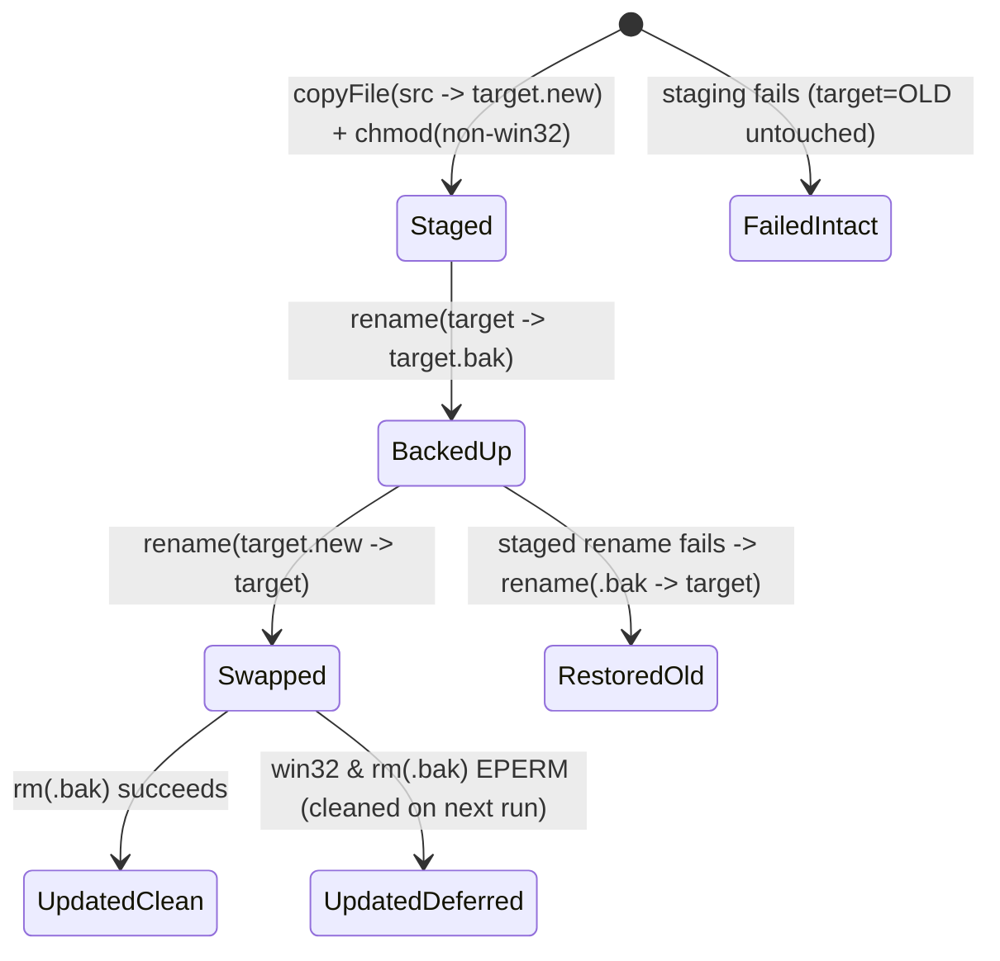
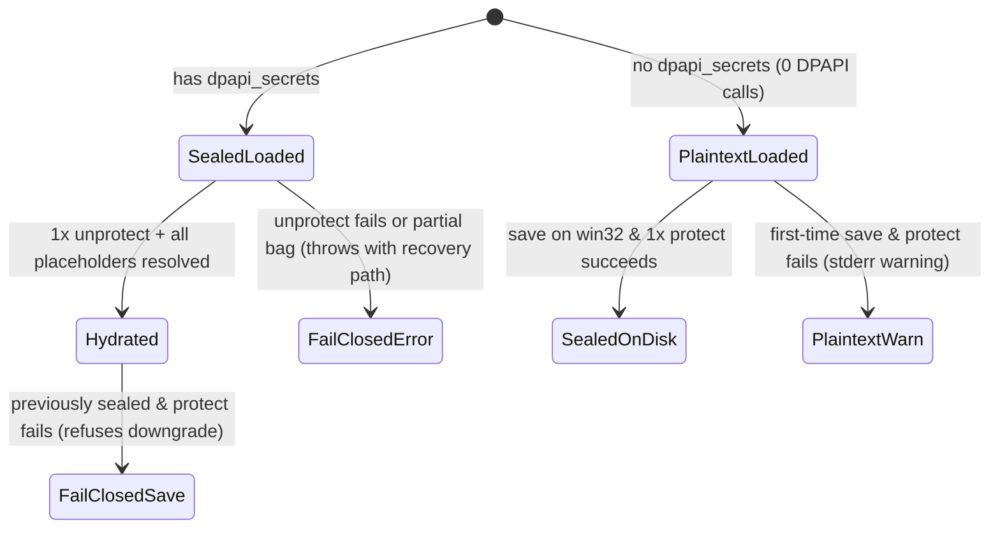
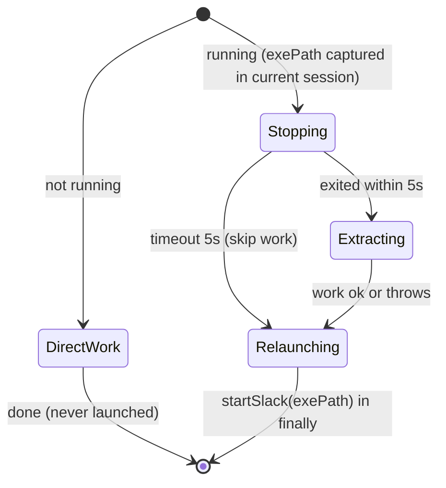

# Verify Windows Support (Formal)

## Run it

```bash
bun .agents/skills/verify-windows-formal/check.ts
```

Exit 0 means every state-space cell and control assertion passed.

## Verified Properties & Statecharts

### 1. Self-Update Binary Safety (`src/lib/update.ts`: `replaceBinaryFile`)

- **Harm if broken**: Windows `EPERM` on `.bak` deletion triggers a rollback or a failed copy leaves `agent-slack.exe` missing.
- **Invariants**:
  - `BinaryAlwaysPresent`: Staging (`target.new`) happens before touching the live binary; after completion or failure, target holds `OLD` or `NEW` (and on double rename failure, surfaces recovery path `target.bak`).
  - `WindowsDeferredBackupNoRollback`: On `win32`, `rm(.bak)` `EPERM` after atomic rename succeeds with `backupCleanupDeferred=true` and target=`NEW`.
  - `LinuxChmodFailKeepsOld`: On `linux`, `chmod` failure cleans up `target.new` and leaves `OLD` untouched.
- **Bounds**: Exhaustive over `platform ∈ {win32, linux} × copyOk × chmodOk × backupRenameOk × stagedRenameOk × rmOk` (64 states).



### 2. DPAPI Credential Store & Auth Fallback (`src/auth/windows-credential-store.ts`, `src/auth/firefox-profile.ts`)

- **Harm if broken**: Plaintext downgrade of encrypted credentials on transient timeout, token loss, partial-bag placeholder leaks, or unhandled crash on Windows auth fallback.
- **Invariants**:
  - `MaxOneDpapiCall`: ≤ 1 `protect` per save and ≤ 1 `unprotect` per load (0 for plaintext).
  - `NoPlaintextLeak`: Sealed JSON never contains raw `xoxc-`/`xoxd-`/`xoxb-` when DPAPI succeeds.
  - `FailClosedOnTransientDecryptError` & `FailClosedOnPartialBag`: Missing/unreadable/incomplete envelope fails closed with recovery hint instead of returning `__DPAPI__` placeholders.
  - `NoSilentPlaintextDowngrade`: Previously sealed files refuse plaintext downgrade on transient `protect` failure.
  - `ExpectedPlatformPaths`: `getFirefoxBaseDir` returns exact platform-native paths and `null` (never throws) on unsupported platforms.
- **Bounds**: Exhaustive over `dataset × dpapiOk` + failure injections + 4 platform path assertions.



### 3. `--restart-slack` Lifecycle (`src/auth/windows-slack-process.ts`: `withWindowsSlackStopped`)

- **Harm if broken**: Extraction kills user's Slack and fails to relaunch it on error, launches Slack when not running, or extracts while still locked.
- **Invariants**:
  - `NeverStartIfNotRunning`: When Slack is not running, exact trace is `work`.
  - `ExactOrderAndExePath`: When running and stopped within 5s, exact trace is `stop -> work -> start(exePath)` even if `work` throws.
  - `NoWorkWhileLocked`: On 5s stop timeout, exact trace is `stop -> start(exePath)` (`work` never runs).
- **Bounds**: Exhaustive over `initiallyRunning × stopMode(3) × workMode(2) × startMode(2)` (24 states).


