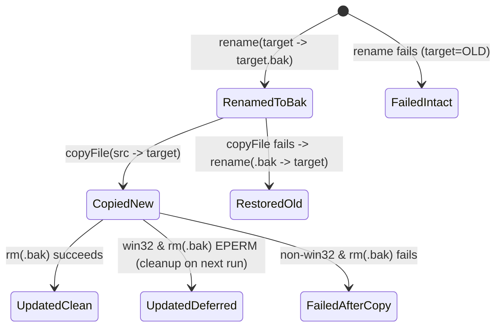
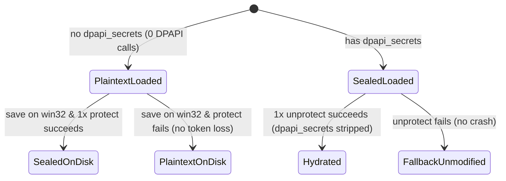
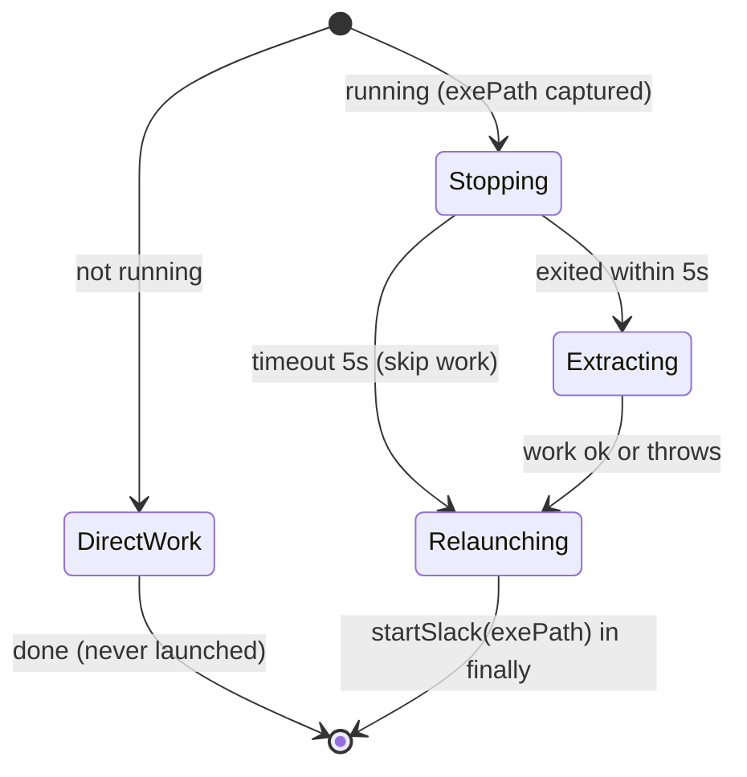

# Verify Windows Support (Formal)

## Run it

```bash
bun .agents/skills/verify-windows-formal/check.ts
```

Exit 0 means every state-space cell and control assertion passed.

## Verified Properties & Statecharts

### 1. Self-Update Binary Safety (`src/lib/update.ts`: `replaceBinaryFile`)

- **Harm if broken**: Windows `EPERM` on `.bak` deletion triggers a rollback or leaves `agent-slack.exe` missing.
- **Invariants**:
  - `BinaryAlwaysPresent`: After completion or failure, target always holds either `OLD` or `NEW` (never missing).
  - `WindowsDeferredBackupNoRollback`: On `win32`, `rm(.bak)` `EPERM` after `copyFile` succeeds with `backupCleanupDeferred=true` and target=`NEW`.
  - `RollbackRestoresOld`: Any `copyFile` failure restores `OLD` via `rename(.bak -> target)`.
- **Bounds**: Exhaustive over `platform ∈ {win32, linux} × renameOk × copyOk × chmodOk × rmOk` (32 states).



### 2. DPAPI Credential Store & Auth Fallback (`src/auth/store.ts`, `src/auth/firefox-profile.ts`)

- **Harm if broken**: Plaintext token leaks on NTFS, token loss during DPAPI failure, O(N) PowerShell latency per CLI call, or unhandled crash on Windows auth fallback.
- **Invariants**:
  - `MaxOneDpapiCall`: ≤ 1 `protect` per save and ≤ 1 `unprotect` per load (0 for plaintext).
  - `NoPlaintextLeak`: Sealed JSON never contains raw `xoxc-`/`xoxd-`/`xoxb-` when DPAPI succeeds.
  - `NoTokenLoss`: Round-trip preserves all workspace credentials even when DPAPI fails (falls back to plaintext).
  - `NoPlatformCrash`: `getFirefoxBaseDir` never throws on any `NodeJS.Platform`.
- **Bounds**: Exhaustive over `dataset ∈ {empty, browserOnly, standardOnly, mixed} × dpapiOk ∈ {T, F}` (8 states) + 5 platforms.



### 3. `--restart-slack` Lifecycle (`src/auth/windows-slack-process.ts`: `withWindowsSlackStopped`)

- **Harm if broken**: Extraction kills user's Slack and fails to relaunch it on error, or launches Slack when the user wasn't running it, or attempts locked DB read after timeout.
- **Invariants**:
  - `NeverStartIfNotRunning`: When Slack is not running, `stopSlack` and `startSlack` are never invoked.
  - `AlwaysRelaunchIfRunning`: When Slack was running, `startSlack(exePath)` is invoked exactly once in `finally` regardless of stop timeout or extraction error.
  - `NoWorkWhileLocked`: On stop timeout (5s default), `work()` is never invoked.
- **Bounds**: Exhaustive over `initiallyRunning × stopMode(3) × workMode(2) × startMode(2)` (24 states).


